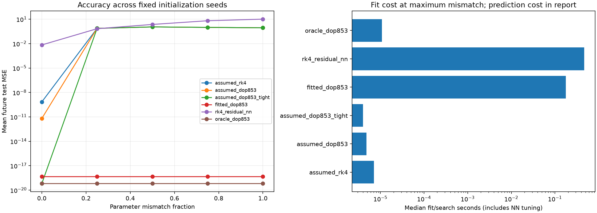
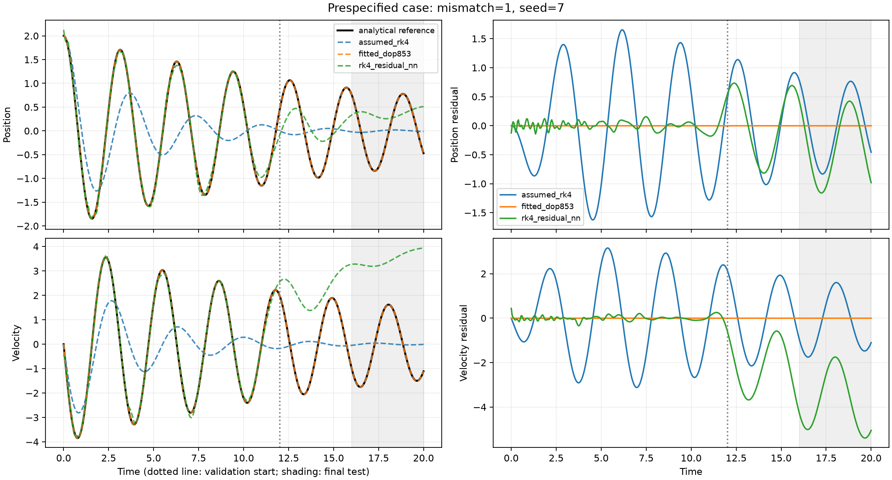

# Day 5: controlled oscillator parameter mismatch

Generated from the saved case records; no table values are entered by hand.

## Setup

- 25 cases: 5 mismatch levels × 5 initialization seeds.
- True parameters: `{'damping': 0.1, 'stiffness': 4.0}`; fully misspecified parameters: `{'damping': 0.5, 'stiffness': 3.0}`.
- Initial state: `[2.0, 0.0]`; time span: `[0.0, 20.0]`; 401 points; no observation noise.
- Chronological split counts: `{'train': 240, 'validation': 80, 'test': 81}`.
- Split time ranges: `{'train': [0.0, 11.950000000000001], 'validation': [12.0, 15.950000000000001], 'test': [16.0, 20.0]}`.
- Both position and velocity are observed; the initial state is known exactly.
- NN alpha and the recommended method are chosen on validation MSE against observations; final test values are accessed only after selection.
- Models are not retrained on validation data. Test trajectories continue from the original initial state without resetting at split boundaries.
- Analytical solution supplies truth. The true-equation DOP853 oracle is a numerical check and cannot be recommended.

## Test error

MSE averages position and velocity in their original units. ± is sample standard deviation over initialization seeds, not a confidence interval.

| Mismatch | Method | Test MSE, mean ± SD | Successful / total | Validation selections |
|---|---|---:|---:|---:|
| 0 | assumed_rk4 | 6.917e-10 ± 0.00e+00 | 5 / 5 | 0 |
| 0 | assumed_dop853 | 6.408e-12 ± 0.00e+00 | 5 / 5 | 0 |
| 0 | assumed_dop853_tight | 6.462e-20 ± 0.00e+00 | 5 / 5 | 5 |
| 0 | fitted_dop853 | 4.691e-19 ± 0.00e+00 | 5 / 5 | 0 |
| 0 | rk4_residual_nn | 6.901e-03 ± 5.25e-03 | 5 / 5 | 0 |
| 0 | oracle_dop853 | 6.462e-20 ± 0.00e+00 | 5 / 5 | 0 |
| 0.25 | assumed_rk4 | 7.524e-01 ± 0.00e+00 | 5 / 5 | 0 |
| 0.25 | assumed_dop853 | 7.524e-01 ± 0.00e+00 | 5 / 5 | 0 |
| 0.25 | assumed_dop853_tight | 7.524e-01 ± 0.00e+00 | 5 / 5 | 0 |
| 0.25 | fitted_dop853 | 4.691e-19 ± 0.00e+00 | 5 / 5 | 5 |
| 0.25 | rk4_residual_nn | 6.800e-01 ± 8.17e-02 | 5 / 5 | 0 |
| 0.25 | oracle_dop853 | 6.462e-20 ± 0.00e+00 | 5 / 5 | 0 |
| 0.5 | assumed_rk4 | 1.125e+00 ± 0.00e+00 | 5 / 5 | 0 |
| 0.5 | assumed_dop853 | 1.125e+00 ± 0.00e+00 | 5 / 5 | 0 |
| 0.5 | assumed_dop853_tight | 1.125e+00 ± 0.00e+00 | 5 / 5 | 0 |
| 0.5 | fitted_dop853 | 4.691e-19 ± 0.00e+00 | 5 / 5 | 5 |
| 0.5 | rk4_residual_nn | 2.267e+00 ± 4.06e-01 | 5 / 5 | 0 |
| 0.5 | oracle_dop853 | 6.462e-20 ± 0.00e+00 | 5 / 5 | 0 |
| 0.75 | assumed_rk4 | 9.890e-01 ± 0.00e+00 | 5 / 5 | 0 |
| 0.75 | assumed_dop853 | 9.890e-01 ± 0.00e+00 | 5 / 5 | 0 |
| 0.75 | assumed_dop853_tight | 9.890e-01 ± 1.24e-16 | 5 / 5 | 0 |
| 0.75 | fitted_dop853 | 4.691e-19 ± 0.00e+00 | 5 / 5 | 5 |
| 0.75 | rk4_residual_nn | 6.471e+00 ± 1.91e+00 | 5 / 5 | 0 |
| 0.75 | oracle_dop853 | 6.462e-20 ± 0.00e+00 | 5 / 5 | 0 |
| 1 | assumed_rk4 | 8.754e-01 ± 0.00e+00 | 5 / 5 | 0 |
| 1 | assumed_dop853 | 8.754e-01 ± 0.00e+00 | 5 / 5 | 0 |
| 1 | assumed_dop853_tight | 8.754e-01 ± 0.00e+00 | 5 / 5 | 0 |
| 1 | fitted_dop853 | 4.691e-19 ± 0.00e+00 | 5 / 5 | 5 |
| 1 | rk4_residual_nn | 1.018e+01 ± 2.05e+00 | 5 / 5 | 0 |
| 1 | oracle_dop853 | 6.462e-20 ± 0.00e+00 | 5 / 5 | 0 |

## Predeclared interpretation

The hybrid counts as practically helpful at a mismatch level only if it lowers test MSE by at least 10%, with an absolute reduction of at least 1e-8, compared with both assumed RK4 and fitted DOP853 in at least 80% of seeds.
Qualifying seed counts by mismatch level: `{'0.0': 0, '0.25': 0, '0.5': 0, '0.75': 0, '1.0': 0}`.
Validation selections across all cases: `{'assumed_dop853_tight': 5, 'fitted_dop853': 20}`.
Failed attempts: 0. NN attempts emitting convergence warnings: 0/50. Warnings and loss curves are retained in each case JSON; a warning is not hidden as successful convergence.

## Cost

| Mismatch | Method | Median fit/search seconds | Median full-grid prediction seconds |
|---|---|---:|---:|
| 0 | assumed_rk4 | 0.000006 | 0.005031 |
| 0 | assumed_dop853 | 0.000005 | 0.004349 |
| 0 | assumed_dop853_tight | 0.000005 | 0.012376 |
| 0 | fitted_dop853 | 0.036241 | 0.009319 |
| 0 | rk4_residual_nn | 0.052796 | 0.005650 |
| 0 | oracle_dop853 | 0.000008 | 0.012586 |
| 0.25 | assumed_rk4 | 0.000006 | 0.005057 |
| 0.25 | assumed_dop853 | 0.000005 | 0.004177 |
| 0.25 | assumed_dop853_tight | 0.000004 | 0.012180 |
| 0.25 | fitted_dop853 | 0.121167 | 0.009306 |
| 0.25 | rk4_residual_nn | 0.164899 | 0.005808 |
| 0.25 | oracle_dop853 | 0.000009 | 0.012670 |
| 0.5 | assumed_rk4 | 0.000007 | 0.005140 |
| 0.5 | assumed_dop853 | 0.000006 | 0.004148 |
| 0.5 | assumed_dop853_tight | 0.000005 | 0.012471 |
| 0.5 | fitted_dop853 | 0.144809 | 0.009429 |
| 0.5 | rk4_residual_nn | 0.324777 | 0.005761 |
| 0.5 | oracle_dop853 | 0.000009 | 0.013226 |
| 0.75 | assumed_rk4 | 0.000005 | 0.004922 |
| 0.75 | assumed_dop853 | 0.000005 | 0.003919 |
| 0.75 | assumed_dop853_tight | 0.000005 | 0.011809 |
| 0.75 | fitted_dop853 | 0.174920 | 0.009489 |
| 0.75 | rk4_residual_nn | 0.427110 | 0.005873 |
| 0.75 | oracle_dop853 | 0.000010 | 0.012566 |
| 1 | assumed_rk4 | 0.000007 | 0.004990 |
| 1 | assumed_dop853 | 0.000005 | 0.003826 |
| 1 | assumed_dop853_tight | 0.000004 | 0.012013 |
| 1 | fitted_dop853 | 0.177897 | 0.009451 |
| 1 | rk4_residual_nn | 0.466764 | 0.005788 |
| 1 | oracle_dop853 | 0.000011 | 0.012949 |

The NN fit/search cost includes both alpha trials. Prediction includes a full baseline integration plus correction; it is not just a network forward pass. Additional prediction cost for the unselected alpha is in metrics.csv. Timings are one measurement per case on one machine with BLAS limited to one thread, not stable performance rankings; module import/first-use overhead can affect early timings. See provenance.json for environment and total run time.

## Figures





## Limits

- One synthetic linear oscillator and one exactly known initial state. No evidence yet for new initial conditions, noisy data, missing terms, or other system families.
- Clean, fully observed data make parameter calibration unusually favorable. Its bounded single-start optimizer is not a universal identification algorithm.
- The NN learns trajectory residuals from time and baseline states, not a corrected differential equation. This evaluation measures future continuation of that specific trajectory.
- Repeated seeds vary NN initialization/minibatch order, not the deterministic reference trajectory. They are not independent physical experiments; no statistical significance claim is made.
- The fixed NN budget and validation window may disadvantage extrapolation. No settings were changed in response to final test scores.
- Lower error from a fit does not prove why it improved. Residual summaries are descriptive, not causal explanations.

## Reproduce

From the repository root, install requirements-research.lock and run:

```bash
python -m adaptive_ode.experiments.mismatch --config experiments/configs/day05_mismatch.json --output experiments/results/day05_reproduction
```

Use a new output directory. Each run preserves its resolved configuration, environment, exact source snapshot and hashes, per-case predictions, validation trials, and test results. Floating-point differences across library versions/hardware are possible; wall-clock times will vary.
