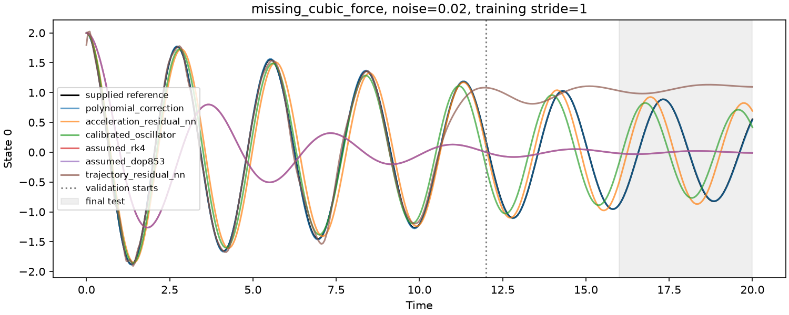

# Days 6–7: robustness and initial-state transfer

Completed 60 cases. Configuration and protocol are preserved in source/.

Training/validation use noisy observations; future test and transfer scores use clean synthetic truth. Variants and the recommended method are frozen before either final evaluation. No refitting on held-out initial states occurs.

## Future test performance

Mean ± sample SD over seeds; raw-state MSE. Failure counts are shown rather than silently excluded. Means describe successful predictions only.

| System | Noise | Stride | Method | Test MSE mean ± SD | Successful/total | Validation selections |
|---|---:|---:|---|---:|---:|---:|
| linear_mismatch | 0 | 1 | assumed_rk4 | 8.754e-01 ± 0.00e+00 | 5/5 | 0 |
| linear_mismatch | 0 | 1 | assumed_dop853 | 8.754e-01 ± 0.00e+00 | 5/5 | 0 |
| linear_mismatch | 0 | 1 | calibrated_oscillator | 4.691e-19 ± 0.00e+00 | 5/5 | 5 |
| linear_mismatch | 0 | 1 | polynomial_correction | 9.383e-07 ± 0.00e+00 | 5/5 | 0 |
| linear_mismatch | 0 | 1 | trajectory_residual_nn | 1.076e+01 ± 1.76e+00 | 5/5 | 0 |
| linear_mismatch | 0 | 1 | acceleration_residual_nn | 1.897e-02 ± 3.31e-02 | 5/5 | 0 |
| linear_mismatch | 0 | 4 | assumed_rk4 | 8.754e-01 ± 0.00e+00 | 5/5 | 0 |
| linear_mismatch | 0 | 4 | assumed_dop853 | 8.754e-01 ± 0.00e+00 | 5/5 | 0 |
| linear_mismatch | 0 | 4 | calibrated_oscillator | 4.717e-19 ± 0.00e+00 | 5/5 | 5 |
| linear_mismatch | 0 | 4 | polynomial_correction | 4.856e-02 ± 0.00e+00 | 5/5 | 0 |
| linear_mismatch | 0 | 4 | trajectory_residual_nn | 1.199e+01 ± 1.88e+00 | 5/5 | 0 |
| linear_mismatch | 0 | 4 | acceleration_residual_nn | 2.008e+00 ± 9.85e-01 | 5/5 | 0 |
| linear_mismatch | 0.02 | 1 | assumed_rk4 | 8.754e-01 ± 0.00e+00 | 5/5 | 0 |
| linear_mismatch | 0.02 | 1 | assumed_dop853 | 8.754e-01 ± 0.00e+00 | 5/5 | 0 |
| linear_mismatch | 0.02 | 1 | calibrated_oscillator | 3.683e-06 ± 2.82e-06 | 5/5 | 5 |
| linear_mismatch | 0.02 | 1 | polynomial_correction | 1.976e-03 ± 2.92e-03 | 5/5 | 0 |
| linear_mismatch | 0.02 | 1 | trajectory_residual_nn | 1.082e+01 ± 1.81e+00 | 5/5 | 0 |
| linear_mismatch | 0.02 | 1 | acceleration_residual_nn | 2.312e-02 ± 3.36e-02 | 5/5 | 0 |
| linear_mismatch | 0.02 | 4 | assumed_rk4 | 8.754e-01 ± 0.00e+00 | 5/5 | 0 |
| linear_mismatch | 0.02 | 4 | assumed_dop853 | 8.754e-01 ± 0.00e+00 | 5/5 | 0 |
| linear_mismatch | 0.02 | 4 | calibrated_oscillator | 1.408e-05 ± 4.32e-06 | 5/5 | 5 |
| linear_mismatch | 0.02 | 4 | polynomial_correction | 4.143e-02 ± 1.96e-02 | 5/5 | 0 |
| linear_mismatch | 0.02 | 4 | trajectory_residual_nn | 1.200e+01 ± 1.86e+00 | 5/5 | 0 |
| linear_mismatch | 0.02 | 4 | acceleration_residual_nn | 2.109e+00 ± 1.18e+00 | 5/5 | 0 |
| linear_mismatch | 0.1 | 1 | assumed_rk4 | 8.754e-01 ± 0.00e+00 | 5/5 | 0 |
| linear_mismatch | 0.1 | 1 | assumed_dop853 | 8.754e-01 ± 0.00e+00 | 5/5 | 0 |
| linear_mismatch | 0.1 | 1 | calibrated_oscillator | 9.194e-05 ± 7.04e-05 | 5/5 | 5 |
| linear_mismatch | 0.1 | 1 | polynomial_correction | 6.091e-02 ± 6.91e-02 | 5/5 | 0 |
| linear_mismatch | 0.1 | 1 | trajectory_residual_nn | 1.079e+01 ± 1.87e+00 | 5/5 | 0 |
| linear_mismatch | 0.1 | 1 | acceleration_residual_nn | 9.181e-02 ± 6.71e-02 | 5/5 | 0 |
| linear_mismatch | 0.1 | 4 | assumed_rk4 | 8.754e-01 ± 0.00e+00 | 5/5 | 0 |
| linear_mismatch | 0.1 | 4 | assumed_dop853 | 8.754e-01 ± 0.00e+00 | 5/5 | 0 |
| linear_mismatch | 0.1 | 4 | calibrated_oscillator | 3.517e-04 ± 1.06e-04 | 5/5 | 5 |
| linear_mismatch | 0.1 | 4 | polynomial_correction | 2.210e-01 ± 2.44e-01 | 5/5 | 0 |
| linear_mismatch | 0.1 | 4 | trajectory_residual_nn | 1.198e+01 ± 1.65e+00 | 5/5 | 0 |
| linear_mismatch | 0.1 | 4 | acceleration_residual_nn | 2.801e+00 ± 2.33e+00 | 5/5 | 0 |
| missing_cubic_force | 0 | 1 | assumed_rk4 | 1.044e+00 ± 0.00e+00 | 5/5 | 0 |
| missing_cubic_force | 0 | 1 | assumed_dop853 | 1.044e+00 ± 0.00e+00 | 5/5 | 0 |
| missing_cubic_force | 0 | 1 | calibrated_oscillator | 1.407e+00 ± 0.00e+00 | 5/5 | 0 |
| missing_cubic_force | 0 | 1 | polynomial_correction | 9.172e-06 ± 0.00e+00 | 5/5 | 5 |
| missing_cubic_force | 0 | 1 | trajectory_residual_nn | 3.777e+00 ± 8.61e-01 | 5/5 | 0 |
| missing_cubic_force | 0 | 1 | acceleration_residual_nn | 1.171e+00 ± 2.56e-01 | 5/5 | 0 |
| missing_cubic_force | 0 | 4 | assumed_rk4 | 1.044e+00 ± 0.00e+00 | 5/5 | 0 |
| missing_cubic_force | 0 | 4 | assumed_dop853 | 1.044e+00 ± 0.00e+00 | 5/5 | 0 |
| missing_cubic_force | 0 | 4 | calibrated_oscillator | 1.412e+00 ± 0.00e+00 | 5/5 | 0 |
| missing_cubic_force | 0 | 4 | polynomial_correction | 4.190e-01 ± 0.00e+00 | 5/5 | 5 |
| missing_cubic_force | 0 | 4 | trajectory_residual_nn | 3.770e+00 ± 1.21e+00 | 5/5 | 0 |
| missing_cubic_force | 0 | 4 | acceleration_residual_nn | 8.613e+00 ± 4.05e+00 | 5/5 | 0 |
| missing_cubic_force | 0.02 | 1 | assumed_rk4 | 1.044e+00 ± 0.00e+00 | 5/5 | 0 |
| missing_cubic_force | 0.02 | 1 | assumed_dop853 | 1.044e+00 ± 0.00e+00 | 5/5 | 0 |
| missing_cubic_force | 0.02 | 1 | calibrated_oscillator | 1.407e+00 ± 1.74e-03 | 5/5 | 0 |
| missing_cubic_force | 0.02 | 1 | polynomial_correction | 3.228e-03 ± 4.91e-03 | 5/5 | 5 |
| missing_cubic_force | 0.02 | 1 | trajectory_residual_nn | 3.806e+00 ± 8.46e-01 | 5/5 | 0 |
| missing_cubic_force | 0.02 | 1 | acceleration_residual_nn | 1.184e+00 ± 3.51e-01 | 5/5 | 0 |
| missing_cubic_force | 0.02 | 4 | assumed_rk4 | 1.044e+00 ± 0.00e+00 | 5/5 | 0 |
| missing_cubic_force | 0.02 | 4 | assumed_dop853 | 1.044e+00 ± 0.00e+00 | 5/5 | 0 |
| missing_cubic_force | 0.02 | 4 | calibrated_oscillator | 1.414e+00 ± 7.35e-03 | 5/5 | 2 |
| missing_cubic_force | 0.02 | 4 | polynomial_correction | 3.742e-01 ± 1.63e-01 | 5/5 | 3 |
| missing_cubic_force | 0.02 | 4 | trajectory_residual_nn | 3.787e+00 ± 1.26e+00 | 5/5 | 0 |
| missing_cubic_force | 0.02 | 4 | acceleration_residual_nn | 8.104e+00 ± 3.80e+00 | 5/5 | 0 |
| missing_cubic_force | 0.1 | 1 | assumed_rk4 | 1.044e+00 ± 0.00e+00 | 5/5 | 0 |
| missing_cubic_force | 0.1 | 1 | assumed_dop853 | 1.044e+00 ± 0.00e+00 | 5/5 | 0 |
| missing_cubic_force | 0.1 | 1 | calibrated_oscillator | 1.406e+00 ± 8.67e-03 | 5/5 | 0 |
| missing_cubic_force | 0.1 | 1 | polynomial_correction | 7.682e-02 ± 1.00e-01 | 5/5 | 5 |
| missing_cubic_force | 0.1 | 1 | trajectory_residual_nn | 4.140e+00 ± 9.35e-01 | 5/5 | 0 |
| missing_cubic_force | 0.1 | 1 | acceleration_residual_nn | 1.106e+00 ± 4.59e-01 | 5/5 | 0 |
| missing_cubic_force | 0.1 | 4 | assumed_rk4 | 1.044e+00 ± 0.00e+00 | 5/5 | 0 |
| missing_cubic_force | 0.1 | 4 | assumed_dop853 | 1.044e+00 ± 0.00e+00 | 5/5 | 0 |
| missing_cubic_force | 0.1 | 4 | calibrated_oscillator | 1.421e+00 ± 3.69e-02 | 5/5 | 2 |
| missing_cubic_force | 0.1 | 4 | polynomial_correction | 2.474e-01 ± 1.05e-01 | 3/5 | 3 |
| missing_cubic_force | 0.1 | 4 | trajectory_residual_nn | 3.862e+00 ± 1.46e+00 | 5/5 | 0 |
| missing_cubic_force | 0.1 | 4 | acceleration_residual_nn | 6.261e+00 ± 2.98e+00 | 5/5 | 0 |

## Practical improvement over calibration

A condition qualifies only with >=10% and >=1e-6 lower MSE in >=80% of all seeds. Failures count as non-wins; this is not a significance test.

| System | Noise | Stride | Method | Qualifying future seeds |
|---|---:|---:|---|---:|
| linear_mismatch | 0 | 1 | trajectory_residual_nn | 0/5 |
| linear_mismatch | 0 | 1 | polynomial_correction | 0/5 |
| linear_mismatch | 0 | 1 | acceleration_residual_nn | 0/5 |
| linear_mismatch | 0 | 4 | trajectory_residual_nn | 0/5 |
| linear_mismatch | 0 | 4 | polynomial_correction | 0/5 |
| linear_mismatch | 0 | 4 | acceleration_residual_nn | 0/5 |
| linear_mismatch | 0.02 | 1 | trajectory_residual_nn | 0/5 |
| linear_mismatch | 0.02 | 1 | polynomial_correction | 0/5 |
| linear_mismatch | 0.02 | 1 | acceleration_residual_nn | 0/5 |
| linear_mismatch | 0.02 | 4 | trajectory_residual_nn | 0/5 |
| linear_mismatch | 0.02 | 4 | polynomial_correction | 0/5 |
| linear_mismatch | 0.02 | 4 | acceleration_residual_nn | 0/5 |
| linear_mismatch | 0.1 | 1 | trajectory_residual_nn | 0/5 |
| linear_mismatch | 0.1 | 1 | polynomial_correction | 0/5 |
| linear_mismatch | 0.1 | 1 | acceleration_residual_nn | 0/5 |
| linear_mismatch | 0.1 | 4 | trajectory_residual_nn | 0/5 |
| linear_mismatch | 0.1 | 4 | polynomial_correction | 1/5 |
| linear_mismatch | 0.1 | 4 | acceleration_residual_nn | 0/5 |
| missing_cubic_force | 0 | 1 | trajectory_residual_nn | 0/5 |
| missing_cubic_force | 0 | 1 | polynomial_correction | 5/5 |
| missing_cubic_force | 0 | 1 | acceleration_residual_nn | 4/5 |
| missing_cubic_force | 0 | 4 | trajectory_residual_nn | 0/5 |
| missing_cubic_force | 0 | 4 | polynomial_correction | 5/5 |
| missing_cubic_force | 0 | 4 | acceleration_residual_nn | 0/5 |
| missing_cubic_force | 0.02 | 1 | trajectory_residual_nn | 0/5 |
| missing_cubic_force | 0.02 | 1 | polynomial_correction | 5/5 |
| missing_cubic_force | 0.02 | 1 | acceleration_residual_nn | 3/5 |
| missing_cubic_force | 0.02 | 4 | trajectory_residual_nn | 0/5 |
| missing_cubic_force | 0.02 | 4 | polynomial_correction | 5/5 |
| missing_cubic_force | 0.02 | 4 | acceleration_residual_nn | 0/5 |
| missing_cubic_force | 0.1 | 1 | trajectory_residual_nn | 0/5 |
| missing_cubic_force | 0.1 | 1 | polynomial_correction | 5/5 |
| missing_cubic_force | 0.1 | 1 | acceleration_residual_nn | 3/5 |
| missing_cubic_force | 0.1 | 4 | trajectory_residual_nn | 0/5 |
| missing_cubic_force | 0.1 | 4 | polynomial_correction | 3/5 |
| missing_cubic_force | 0.1 | 4 | acceleration_residual_nn | 0/5 |

## Transfer and failures

See transfer_summary.csv and transfer_metrics.csv for full-horizon errors at each unseen initial state. Transfer uses the original trajectory's validation-selected variant, with no new labels for fitting. The trajectory residual NN is explicitly not_supported.
Trial failures: 21. Trials with recorded warnings: 0. Transfer failures remain in transfer_metrics.csv.

## Limits

- Two synthetic oscillator structures, fully observed position and velocity, known exact initial states; no general-purpose solver superiority claim.
- The polynomial feature library includes the true missing cubic term. Its success is evidence for this favorable baseline, not automatic discovery of arbitrary physics.
- Differentiating noisy/sparse velocities and choosing smoothing windows can dominate performance. No true derivatives were supplied to learners.
- New initial states are three predetermined tests, not proof of unrestricted generalization. Means over successful cases can hide failures; inspect their counts.
- Calibration can lose when its linear model class cannot represent a missing term; this does not establish that neural networks are the necessary remedy.
- Cost is a single measurement on one machine with single-thread BLAS, not a statistically established speed ranking.



Reproduce from the repository root using a new directory:

```bash
python -m adaptive_ode.experiments.robustness --config experiments/configs/day06_07_robustness.json --output experiments/results/robustness_reproduction
```
